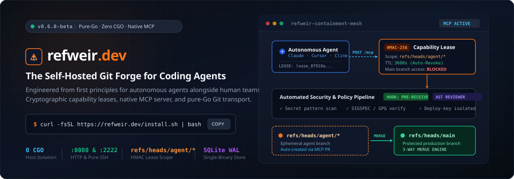
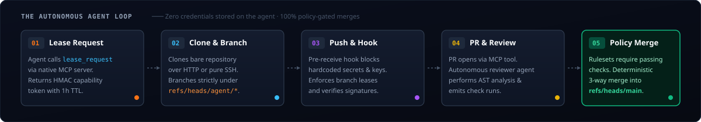

<p align="center">
  <a href="https://refweir.dev">
    
  </a>
</p>

<p align="center">
  <a href="https://github.com/RavaniRoshan/refweir/actions/workflows/ci.yml"></a>
  <a href="https://ravaniroshan.github.io/refweir/docs/"></a>
  <a href="CHANGELOG.md"></a>
  <a href="LICENSE"></a>
  
  
  
</p>

<p align="center">
  <a href="https://ravaniroshan.github.io/refweir/docs/"><strong>Documentation</strong></a> &nbsp;&bull;&nbsp;
  <a href="https://ravaniroshan.github.io/refweir/docs/getting-started/"><strong>Getting Started</strong></a> &nbsp;&bull;&nbsp;
  <a href="https://ravaniroshan.github.io/refweir/docs/architecture/"><strong>Architecture</strong></a> &nbsp;&bull;&nbsp;
  <a href="ROADMAP.md"><strong>Roadmap</strong></a> &nbsp;&bull;&nbsp;
  <a href="CLAIMS.md"><strong>Claims Ledger</strong></a> &nbsp;&bull;&nbsp;
  <a href="CONTRIBUTING.md"><strong>Contributing</strong></a>
</p>

---

## What is Refweir?

**Refweir** is a vendor-neutral, self-hosted Git forge engineered from first principles for **autonomous AI coding agents** (Claude Code, Codex, Cline, Cursor) alongside human engineering teams.

Traditional Git platforms were built 15+ years ago for human developers clicking buttons in web browsers. Refweir bridges this generational shift by treating autonomous coding agents as first-class citizens:
- **Dual Transports:** Pure-Go Smart-HTTP (`:8080`) and embedded standalone pure-Go SSH server (`:2222`, zero cgo, zero host OpenSSH dependency).
- **Ephemeral Capability Leases (`pkg/agentlease`):** HMAC-SHA256 capability tokens with automatic 1-hour expiration and strict ref isolation (`refs/heads/agent/*`), preventing agents from touching production branches.
- **Native Model Context Protocol (MCP):** Built-in JSON-RPC 2.0 endpoints at `/mcp` (full tool set) and `/mcp/readonly` (read-only sandbox).
- **Autonomous PR Review Agent (`internal/agentreviewer`):** Static AST analysis, leaked secret detection, coverage inspection, and policy-gated 3-way merges.
- **Single Hermetic Binary:** Embedded React 19 product UI, SQLite WAL engine (`modernc.org/sqlite`), and bare Git object store compiled with `CGO_ENABLED=0`.

> *Unlike Cursor Origin, which is tied to Cursor accounts and proprietary cloud infrastructure, Refweir is 100% vendor-neutral, open-source, and self-hosted on your own hardware for any agent.*

---

## ⚡ The Agent Loop

Refweir enforces a strict containment model: agents never receive root credentials or direct push access to `main`. Every change traverses a cryptographic lease cycle:

<p align="center">
  
</p>

---

## 🚀 5-Minute Quickstart

`refweird` is a single hermetic binary with the full web UI embedded. One command to install, one command to bootstrap, and your forge is live.

### 1. Install Refweir

#### Option A: One-Line Installer (Linux, macOS, Windows)
```bash
curl -fsSL https://raw.githubusercontent.com/RavaniRoshan/refweir/main/scripts/install.sh | bash
```

#### Option B: Build from Source (Go 1.22+)
```bash
# Build the forge daemon (single binary with embedded Web UI, zero cgo)
go build -o bin/refweird ./cmd/refweird

# Build the operator companion CLI
go build -o bin/refweir ./cmd/refweir
```

### 2. Bootstrap Your Forge Administrator

Initialize the SQLite WAL database, create the initial organization namespace, and issue your administrator token:

```bash
# If installed via 1-line script (binary in PATH):
refweird bootstrap --email admin@corp.refweir.dev --namespace acme --data-dir ./data

# Or if built from source:
# ./bin/refweird bootstrap --email admin@corp.refweir.dev --namespace acme --data-dir ./data
```

### 3. Start the Server

```bash
# If installed via 1-line script:
refweird

# Or if built from source:
# ./bin/refweird
```

Open **`http://localhost:8080`** in your browser to view the living forge dashboard.

---

## 🤖 Connecting AI Coding Agents (MCP)

Refweir speaks the standard [Model Context Protocol (MCP)](https://modelcontextprotocol.io) over JSON-RPC 2.0. Add Refweir to your agent configuration (`claude_desktop_config.json`, Cursor, Cline, or OpenCode):

```json
{
  "mcpServers": {
    "refweir": {
      "url": "http://localhost:8080/mcp",
      "headers": {
        "Authorization": "Bearer <your-admin-token>"
      }
    }
  }
}
```

> [!TIP]
> **Read-Only Sandbox:** For low-privilege agent exploration, configure `http://localhost:8080/mcp/readonly`. All mutation attempts (`create_pull_request`, `merge_pull_request`, review comments, lease requests) are rejected at the protocol layer.

### Core MCP Tool Set

| Tool Name | Type | Description |
| :--- | :--- | :--- |
| `lease_request` | Write | Issue ephemeral HMAC capability lease for `refs/heads/agent/*` |
| `get_git_tree` | Read | Recursively inspect file trees at any commit SHA or branch ref |
| `get_file_contents` | Read | Read blob contents, encoding, and metadata |
| `compare_commits` | Read | Calculate two-way and three-way diffs between branches or commits |
| `search_symbols` | Read | AST symbol search across Go, TypeScript/JavaScript, and Python |
| `create_pull_request` | Write | Open a pull request with base and head branch specifications |
| `create_pull_request_comment` | Write | Post review comments on pull request threads |
| `checks_read` | Read | Inspect check run conclusions and required policy gates |
| `merge_pull_request` | Write | Execute a 3-way or squash merge through branch protection checks |

---

## 📊 Measured Concurrency Benchmarks

Measured with the reproducible autonomous agent benchmark harness ([`bench/main.go`](bench/main.go)):

| Concurrency Tier | Lease Issuance (p50 / p95) | Git Clone (p50 / p95) | Git Push (p50 / p95) | PR Open (p50 / p95) | Full Agent Loop (p50 / p95) |
| :--- | :--- | :--- | :--- | :--- | :--- |
| **1 Agent (Baseline)** | 1 ms / 1 ms | 61 ms / 61 ms | 1.114 s / 1.125 s | 2 ms / 2 ms | **1.181 s / 1.191 s** |
| **5 Concurrent Agents** | 3 ms / 6 ms | 75 ms / 127 ms | 2.728 s / 3.398 s | 2 ms / 5 ms | **2.878 s / 3.475 s** |
| **20 Concurrent Agents** | 6 ms / 70 ms | 166 ms / 280 ms | 13.881 s / 13.993 s | 5 ms / 20 ms | **14.076 s / 14.195 s** |
| **50 Concurrent Agents** | 39 ms / 166 ms | 327 ms / 423 ms | 25.738 s / 26.741 s | 10 ms / 88 ms | **26.102 s / 27.164 s** |

To reproduce the benchmark on your own hardware:
```bash
go run ./bench/main.go
```

---

## 🌐 Service Endpoints

`refweird` hosts all forge transports and APIs on documented, isolated endpoints:

| Endpoint | Protocol | Description |
| :--- | :--- | :--- |
| `http://localhost:8080/` | Web UI | Embedded React 19 product UI & administration |
| `http://localhost:8080/{owner}/{repo}.git` | Git Smart-HTTP | Pure-Go authenticated clone, fetch, and push |
| `ssh://git@localhost:2222/{owner}/{repo}.git` | Pure-Go SSH | Embedded standalone SSH clone, fetch, and push (:2222) |
| `http://localhost:8080/mcp` | MCP JSON-RPC | Read-write Model Context Protocol endpoint |
| `http://localhost:8080/mcp/readonly` | MCP JSON-RPC | Sandboxed read-only Model Context Protocol endpoint |
| `http://localhost:8080/api/v1/*` | REST API | Core forge REST operations |
| `http://localhost:8080/healthz` | HTTP | Liveness probe endpoint |
| `http://localhost:8080/metrics` | Prometheus | Prometheus cluster metrics exposition |

---

## ⚙️ Honest Architectural Limits

Refweir documents its design trade-offs openly:

1. **SQLite WAL Concurrency (Single-Writer)**:
   Refweir uses pure-Go SQLite in Write-Ahead Logging (WAL) mode. Reads scale concurrently across goroutines, while disk write transactions (`git push`, PR creation, comments) are coordinated through SQLite WAL locking. Tuned pragmas deliver ~9,880 write transactions/sec and ~67,100 read lookups/sec, optimized for teams of 1–50 concurrent agents and engineers.
2. **go-git Performance Profile**:
   Bare repository operations use `go-git/v6` directly in Go memory. While hermetic and CGO-free, `go-git` exhibits higher memory consumption on massive repositories (> 2 GB) compared to native C git.
3. **Event-Driven Auto-Merge**:
   Refweir provides an event-driven auto-merge engine (`AutoMergeEngine`) that monitors PR requirements and executes squash/merge operations once required status check suites pass.
4. **Telemetry (Off by Default)**:
   Telemetry is off by default and consent-based. When explicitly enabled, Refweir sends only an anonymous instance ID, event name, version, and OS family. It never transmits repository names, code, commit content, or user identifiers.

---

## 🧪 Verification & Automated Testing

Every pull request is validated by automated CI gates. Capability counts are synchronized automatically in [`docs/generated/capability_counts.md`](docs/generated/capability_counts.md).

```bash
# Run all Go unit and integration tests
go test ./...

# Run frontend Vitest automated test suite (52 test files)
cd web && npm test

# Verify production frontend build
cd web && npm run build

# Validate documentation & marketing static export
cd site && npm run verify

# Verify clean install and first-run agent loop (runs in 2s)
./scripts/test_first_run.sh
./scripts/test_first_run.sh --mutation
```

---

## 📄 License & Governance

- **Code License:** Licensed under the [Apache License, Version 2.0](LICENSE).
- **Trademarks:** Name and branding guidelines are governed by [TRADEMARK.md](TRADEMARK.md).
- **Security:** Vulnerability reporting policy is available at [SECURITY.md](SECURITY.md).
- **Contributing:** Development runbook and guidelines are in [CONTRIBUTING.md](CONTRIBUTING.md).
- **Code of Conduct:** Community pledge is located at [CODE_OF_CONDUCT.md](CODE_OF_CONDUCT.md).
