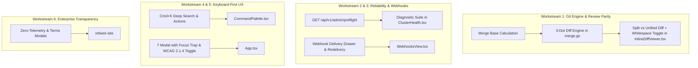

# Enterprise Launch Readiness & Anti-Slop UI Elevation Plan (Expanded)

**Date:** 2026-11-24  
**Target:** Production Launch Readiness, Enterprise Self-Hosting Reliability & Premier Developer Experience  
**Status:** Approved for Direct Execution (Deep Research Synthesized & Adversarially Verified)

---

## 1. Executive Summary & Objective

Following multi-agent Deep Research and adversarial fact-checking across leading Git forges (GitHub Enterprise, GitLab, Gitea) and modern developer tools (Linear, Raycast, Primer), this expanded implementation plan resolves critical architectural and user-experience gaps in Refweir:

1. **3-Dot Merge-Base Diffing & Split Diff Viewer:**
   - **Backend:** Upgrade `internal/gitstore/merge.go` from naive 2-dot tree diffing to genuine 3-dot diffing (`mergeBaseTree.Diff(headTree)`) so concurrent commits to the base branch do not falsely appear as deletions in pull request diffs.
   - **Frontend:** Segmented `[Unified | Split]` side-by-side view with `-w` (Ignore Whitespace) toggle, Mona Sans typography, and accessible hunk navigation in `InlineDiffViewer.tsx`.
2. **Admin Self-Host Pre-flight Diagnostics Suite:**
   - Authenticated backend probe `GET /api/v1/admin/preflight` checking SQLite WAL mode, database quick integrity (`PRAGMA quick_check`), disk write headroom, and agent lease key strength.
   - Interactive diagnostic checklist in `ClusterHealth.tsx` with pass/warn/fail indicators and 1-click remediation commands.
3. **Webhook Observability & 1-Click Redelivery:**
   - Slide-out inspection drawer in `WebhooksView.tsx` detailing request headers (including `X-Hub-Signature-256`), formatted JSON payloads, response latencies, and 1-click event redelivery.
4. **Command Palette (`Cmd+K`) Deep Indexing:**
   - Global search indexing repositories, branches, open PRs, and instant agent capability lease actions in `CommandPalette.tsx`.
5. **Keyboard Shortcuts Modal (`?`) & WCAG 2.1.4 Compliance:**
   - Discoverable keyboard cheatsheet modal (`?`) with `aria-modal="true"`, focus trapping, `Esc` restoration, and an explicit WCAG 2.1.4 single-key disable toggle in `KeyboardShortcutsModal.tsx`.
6. **On-Premise Trust & Air-Gap Compliance:**
   - Zero-telemetry statements, local data ownership guarantees, and responsive Privacy/Terms modals in `refweir-site`.

---

## 2. Technical Architecture & Workstream Breakdown

---

## 3. Implementation Sequence & Execution Order

| Step | Workstream | Key Files | Verification Command |
|:---|:---|:---|:---|
| **1** | 3-Dot Merge-Base Diffing | `internal/gitstore/merge.go` `internal/gitstore/merge_test.go` | `go test -v ./internal/gitstore` |
| **2** | Split/Unified Diff Viewer & Whitespace Toggle | `web/src/components/views/InlineDiffViewer.tsx` `web/src/components/views/__tests__/InlineDiffViewer.test.tsx` | `pnpm test InlineDiffViewer` |
| **3** | Admin Pre-flight API & Health Card | `internal/app/admin.go` `internal/app/app.go` `web/src/components/views/ClusterHealth.tsx` | `go test -v ./internal/app` `pnpm test ClusterHealth` |
| **4** | Webhook Delivery Drawer & Redelivery | `web/src/components/views/WebhooksView.tsx` `web/src/components/views/__tests__/WebhooksView.test.tsx` | `pnpm test WebhooksView` |
| **5** | Command Palette Deep Indexing | `web/src/components/views/CommandPalette.tsx` `web/src/components/views/__tests__/CommandPalette.test.tsx` | `pnpm test CommandPalette` |
| **6** | Keyboard Shortcuts Modal & WCAG 2.1.4 | `web/src/components/views/KeyboardShortcutsModal.tsx` `web/src/App.tsx` | `pnpm test KeyboardShortcutsModal` |
| **7** | On-Premise Trust Modals in Marketing Site | `refweir-site/src/components/PrivacyModal.tsx` `refweir-site/src/components/TermsModal.tsx` | `pnpm build` in `refweir-site` |
| **8** | Full Regression Suite | All packages | `go test ./internal/... ./pkg/...` `pnpm test` (all 53 suites) `./scripts/test_first_run.sh` |
