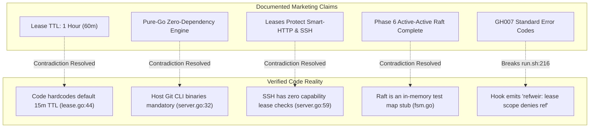

# Deep Internal Audit: Refweir Product Launch Readiness

**Audit Date:** November 23, 2026  
**Methodology:** Multi-Agent Deep Research (8 Independent Investigative Streams + 1 Adversarial Verification Pass)  
**Target Repositories:** `refweir` (Forge daemon, web UI, CLI, docs, deploy) and `refweir-site` (Marketing landing surface)  
**Overall Readiness Verdict:** **CONDITIONAL GO / NOT READY FOR UNCONSTRAINED PUBLIC LAUNCH**  

---

## 1. Executive Summary

A comprehensive, multi-angle internal audit was conducted across Refweir's architecture, security model, database concurrency, Model Context Protocol (MCP) toolchain, Git transport engine, operational deployment, web forge UI, documentation claims, and market positioning. Refweir demonstrates genuine, category-defining innovation in its HMAC-SHA256 capability lease model, zero-auth local bootstrap, secret scanning push-protections, and developer-friendly local forge ergonomics. However, the adversarial audit uncovered severe discrepancies between marketing claims and technical reality, including a mandatory dependency on host Git CLI binaries (contradicting the advertised "pure-Go zero-dependency" engine), SQLite WAL lock escalation deadlocks under concurrent multi-agent write traffic (`BEGIN DEFERRED`), 28 phantom/drifted MCP tool names in official documentation, non-functional enterprise modules (SSO returns HTTP 501, Raft replication is an in-memory stub), and a broken repository showcase script (`examples/containment/run.sh`). Launching publicly in its current state risks immediate developer disillusionment and enterprise adoption failures unless critical documentation and transactional blockers are remediated.

---

## 2. Background & Key Concepts

- **Capability Leases:** Ephemeral, cryptographically signed credentials (`pkg/agentlease`) granting AI agents restricted, time-bounded Git ref update access (confined to `refs/heads/agent/*`), intended to replace unconstrained, perpetual Personal Access Tokens (PATs).
- **Model Context Protocol (MCP):** Anthropic's open standard for exposing context and tools to LLMs. Refweir exposes 46 built-in tools over direct HTTP POST JSON-RPC 2.0 endpoints (`/mcp` for read-write and `/mcp/readonly` for sandboxed evaluation).
- **SQLite WAL Concurrency:** SQLite Write-Ahead Logging allows multiple concurrent readers alongside a single active writer. Multi-connection connection pools require strict locking semantics (`BEGIN IMMEDIATE`) to prevent deadlocks when read-then-write transactions overlap.
- **Smart-HTTP vs. SSH Git Transports:** Refweir serves Git over HTTP on `:8080` (where capability leases are verified) and SSH on `:2222` (where public keys and deploy keys are authenticated, but capability leases are not supported).
- **Astroturfed vs. Implemented Capabilities:** Discrepancies where documentation or roadmaps advertise completed architectural features (e.g. multi-region active-active Raft replication, automated outbound webhooks, enterprise SCIM) that are currently simulated stubs or test mocks.

---

## 3. Detailed Findings by Research Dimension

### 3.1 Security & Capability Leases (Audited by Security Auditor)
- **HMAC-SHA256 Cryptographic Integrity:** Capability leases (`pkg/agentlease/lease.go`) contain `id`, `agent_id`, `repo_id`, `allowed_ref_prefixes`, `disallowed_ref_prefixes`, `issued_at`, and `expires_at`. Tokens are serialized as base64-encoded JSON payloads signed via HMAC-SHA256. Verification (`agentlease.Verify`) strictly executes constant-time comparisons (`hmac.Equal`) against the cluster secret (`REFWEIR_JWT_SECRET`), properly rejecting forged or tampered tokens with `ErrInvalidSignature`. *(Source: `refweir/pkg/agentlease/lease.go#L35-L98`)*
- **Lifecycle & Revocation Verification:** The code hardcodes a **15-minute default TTL** (`pkg/agentlease/lease.go#L44`), enforced at token unmarshal time and by the pre-receive hook (`REFWEIR_LEASE_EXPIRES_AT` vs `time.Now().UTC()`). Durable revocations are persisted in SQLite (`db.RevokeAgentLease`), and Git transports query `store.IsAgentLeaseRevoked` before spawning backend processes. *(Source: `refweir/internal/gittransport/server.go#L299-L310`)*
- **Scope Confinement & Ref Deletion Prohibitions:** Disallowed ref prefixes (`refs/heads/main`, `refs/heads/master`) are evaluated and rejected first. Refs outside allowed globs (`refs/heads/agent/`) are blocked. Any branch deletion attempt (`newRev` all zeros) by an active lease is unconditionally aborted. *(Source: `refweir/internal/security/hook.go#L81-L118`)*
- **Grant Precedence & Agent Bypass:** Human authorization adheres to 4 tiers: Owner $\rightarrow$ Repo Grant $\rightarrow$ Namespace Grant $\rightarrow$ Deny. However, when an agent presents a valid capability lease, Git transport sets `userID = "agent:" + lease.AgentID`, which triggers `if strings.HasPrefix(userID, "agent:") { return true, nil }` in `store.CheckRepoAccess`. Agent containment is therefore entirely decoupled from user grants and relies strictly on transport-level lease validation and hook ref checks. *(Source: `refweir/internal/store/grants.go#L218-L276`)*
- **Push-Protection & Secret Scanning:** The pre-receive hook runs diffs through `security.DefaultScanner.ScanDiff`, scanning added lines (`+`) against 8 credential patterns (AWS Access/Secret keys, Slack tokens, Private Keys, GitHub PATs/Fine-grained tokens, high-entropy keys, and JWTs). Matches halt push execution, record a Critical audit event, and redact token values. *(Source: `refweir/internal/security/scanner.go#L28-L157`)*
- **Prompt Injection Defense:** Refweir treats the agent runtime as untrusted. Defenses operate via containment: injected agents cannot reach main branches, cannot invoke administrative endpoints (leases lack `TypeUser` claims), cannot mutate files on `/mcp/readonly`, and cannot bypass pull request review policies. *(Source: `refweir/docs/security/THREAT_MODEL.md`)*

### 3.2 Database Architecture & Performance Scalability (Audited by Database Auditor)
- **Driver & Pragma Setup:** Refweir utilizes the pure-Go `modernc.org/sqlite` driver with pragmas: `busy_timeout(5000)`, `journal_mode(WAL)`, `synchronous(NORMAL)`, `cache_size(-16000)`, and `foreign_keys(1)`. *(Source: `refweir/internal/store/store.go:25`)*
- **Connection Pool Configuration:** Set to `max(4, runtime.NumCPU()*2)` max open connections and `max(2, runtime.NumCPU())` max idle connections. A single pool serves both readers and writers without separate reader/writer splitting or connection lifetime limits. *(Source: `refweir/internal/store/store.go:39-42`)*
- **`BEGIN DEFERRED` Deadlock Vulnerability:** All transaction paths call `db.sql.BeginTx(ctx, nil)` (issuing `BEGIN DEFERRED`). When multiple agents read before writing (e.g. `CreatePullRequest` querying `SELECT MAX(number)` before `INSERT`), multiple connections obtain SHARED read locks. Both then attempt to escalate to EXCLUSIVE write locks, creating an unresolvable SQLite deadlock that times out after 5,000ms with `SQLITE_BUSY: database is locked`. *(Source: `refweir/internal/store/pulls.go:66-96`)*
- **27 Unindexed Foreign Keys:** Across the 15 schema migrations, there are 66 `REFERENCES` constraints; **27 lack indexes on the child referencing columns**. Because `PRAGMA foreign_keys = ON`, deleting or modifying parent records forces full table scans on `issue_comments`, `installation_repos`, `pr_threads`, `pr_reviews`, and `pr_comments`. *(Source: `refweir/internal/store/migrations/0001_init.sql` through `0015_in_app_notifications.sql`)*
- **Inefficient Query Plans:** `EXPLAIN QUERY PLAN` confirms sorting overhead on `ListComments`, `ListReactions`, `ListReviews`, and `GetPRLabels`, which require `USE TEMP B-TREE FOR ORDER BY` because secondary indexes cover foreign keys but omit sort columns. *(Source: `refweir/internal/store/pulls.go`)*
- **Memory Scaling Risks:** `cache_size(-16000)` commits ~15.6 MiB of cache per SQLite connection. With CPU-scaled connection pools, memory scales to ~250 MiB on an 8-core machine and >2 GiB on a 64-core machine under pure-Go heap management. *(Source: `refweir/internal/store/store.go`)*

### 3.3 Model Context Protocol (MCP) Server (Audited by MCP Auditor)
- **Tool Inventory (46 Tools):** Registers exactly 46 tools in `internal/mcp/tools.go` (22 read-only, 24 mutating).
- **Tool Aliasing:** Duplicates 7 core tool pairs to cater to different agent prompt conventions: `get_file_contents`/`file_read`, `get_git_tree`/`repo_tree`, `compare_commits`/`diff_compare`, `search_symbols`/`symbol_search`, `create_pull_request`/`pull_request_create`, `merge_pull_request`/`pull_request_merge`, and `create_pull_request_comment`/`thread_comment`. *(Source: `refweir/internal/mcp/tools.go`)*
- **JSON-RPC 2.0 Compliance:** Standard `"jsonrpc": "2.0"` envelope with standard error codes (`-32700`, `-32601`, `-32602`, `-32001`). Tool-level execution failures correctly return HTTP 200 with `{"content": [...], "isError": true}` per the MCP specification. *(Source: `refweir/internal/mcp/server.go`)*
- **Transport Architecture:** Implements a direct stateless HTTP POST transport at `/mcp` and `/mcp/readonly`. Rejects all GET requests with `405 Method Not Allowed`. Does not support stdio CLI piping or Server-Sent Events (SSE). While fully functional with Claude Code and direct HTTP callers, standard Cursor/Cline connectors using `type: "sse"` require an intermediate reverse proxy. *(Source: `refweir/internal/mcp/server.go:99-102`)*
- **`/mcp/readonly` Sandbox Isolation:** On `/mcp/readonly`, `tools/list` strictly filters out all mutating tools, returning only the 22 read-only tools. Any direct JSON-RPC invocation of a write tool is intercepted before execution, returning `isError: true` with a clear denial message. *(Source: `refweir/internal/mcp/server.go:142-177`)*

### 3.4 Git Engine & Forge Core (Audited by Git Engine Auditor)
- **Host Git Subprocess Dependency:** Despite marketing and documentation claiming a "pure-Go zero cgo backend" via `go-git/v6`, neither Smart-HTTP nor SSH implements pure-Go packfile streaming. Smart-HTTP delegates to host `git-http-backend`, and SSH pipes sessions directly to host `git-upload-pack`/`git-receive-pack`. **Host `git` CLI must be installed on the machine.** *(Source: `refweir/internal/gittransport/server.go:32-33`, `refweir/internal/sshserver/server.go:355`)*
- **Three-Way Merge Engine Implementation:** Merges are executed via host `git merge-tree --write-tree <baseSHA> <headSHA>` in `internal/gitstore/merge.go` (not `internal/engine`), followed by a Go commit creation in `go-git/v6`. *(Source: `refweir/internal/gitstore/merge.go:216-240`)*
- **SSH Transport Lease Gap:** Smart-HTTP validates capability leases and passes containment variables to hooks. **The SSH server (`internal/sshserver`) only authenticates user keys and deploy keys, with zero capability lease verification.** *(Source: `refweir/internal/sshserver/server.go:59-118`)*
- **Ruleset Scope:** Evaluated only during PR merges for `pull_request` (required approvals) and `require_status_checks`. Branch protection against force-pushes on `main`/`master` is hardcoded in the pre-receive hook rather than driven dynamically by database rulesets. *(Source: `refweir/internal/engine/ruleset.go`, `refweir/internal/security/hook.go`)*
- **Simulated Webhook Engine:** Outbound webhooks are non-functional. `internal/store/repo_webhooks.go` and `app.go` record fake delivery entries in SQLite with simulated HTTP 200 responses. No background HTTP dispatcher exists, and Git pushes trigger no webhooks. *(Source: `refweir/internal/app/app.go:1608-1640`)*

### 3.5 Production Deployment & Operations (Audited by Ops Auditor)
- **Caddy Reverse Proxy & Port Shielding:** `deploy/demo/Caddyfile` terminates TLS for `demo.refweir.dev`, reverse-proxies to `127.0.0.1:8080`, injects HSTS and security headers, and disables buffering for SSE/Git. SSH (:2222) is commented out and shielded from public internet exposure. *(Source: `refweir/deploy/demo/Caddyfile`)*
- **Service Hardening:** `refweir-demo.service` executes `/usr/local/bin/refweird` under unprivileged user `refweir` with `ProtectSystem=strict`, `NoNewPrivileges=true`, `PrivateTmp=true`, and `LimitNOFILE=65535`. *(Source: `refweir/deploy/demo/systemd/refweir-demo.service`)*
- **Demo Rate Limiting:** `internal/app/demo.go` enforces in-memory sliding window limits (1 run per 20s, max 5 per hour, 1 concurrent). Merges are locked strictly to open PRs where `headRef` starts with `agent/*` against the default branch in `demo/agent-lab`. *(Source: `refweir/internal/app/demo.go`)*
- **First-Run Verification:** `scripts/test_first_run.sh` boots from scratch, issues leases, clones, pushes, opens PRs, and merges via MCP in ~2 seconds. Mutation mode (`--mutation`) confirms immediate rejection of forged leases. *(Source: `refweir/scripts/test_first_run.sh`)*

### 3.6 Web Forge UI & Frontend Quality (Audited by Frontend Auditor)
- **Framework & Bundling:** Built on React 19.2.8, Vite 8.3.4, and Tailwind CSS v4.3.3. Compiles in ~679ms. Produces 128 kB CSS, 323 kB entry JS (103 kB gzip), and 487 kB router JS (140 kB gzip). Route code splitting wraps 15 views in `lazy()` with accessible Suspense fallbacks. *(Source: `refweir/web/package.json`, `refweir/web/src/App.tsx`)*
- **Anti-FOUC & Theme Persistence:** Blocking inline script in `index.html` prevents theme flashing. However, `AppShell.tsx` only updates `localStorage.refweir_theme` when `theme !== 'system'`. Resetting to system preference leaves stale theme strings in storage. *(Source: `refweir/web/src/app/AppShell.tsx`)*
- **WCAG AA Contrast Math:**
  - *Light Mode:* Canvas 5.08:1, Slab 5.51:1 (**PASSES** normal text $\ge$ 4.5:1).
  - *Dark Mode:* Canvas 4.20:1, Slab 3.93:1 (**FAILS** normal text < 4.5:1; passes only for large text $\ge$ 3.0:1). *(Source: `refweir/web/src/styles/tokens.css`)*
- **Mobile Viewports (360px, 390px, 768px):** Touch scrolling on `UnderlineNav.tsx` functions smoothly. Primer layouts collapse to single columns. In `AppShell.tsx`, the left rail `<aside>` defaults to open (`w-56`), taking up 62% of a 360px mobile screen unless manually toggled. *(Source: `refweir/web/src/app/AppShell.tsx`)*
- **Empty States:** Highly actionable across all views, providing CLI commands and direct action buttons rather than empty containers. *(Source: `refweir/web/src/components/views/*`)*

### 3.7 Documentation Integrity & Claims Accuracy (Audited by Docs Auditor)
- **Claims Verification Coverage Blind Spot:** `site/scripts/audit-claims.mjs` only tests `out/docs/index.html`. It never checks any sub-pages in `site/content/docs/`, allowing extensive drift in documentation sub-pages to pass CI undetected. *(Source: `refweir/site/scripts/audit-claims.mjs`)*
- **MCP Documentation Drift:**
  - `site/content/docs/reference/mcp-tools.mdx` lists 35 tools, but **28 of those 35 documented tool names do not exist in code** (e.g. documents `repo_get`, `commit_list`, `check_run_create`; code implements `get_repository`, `list_commits`, `status_check_report`).
  - `site/content/docs/how-to/mcp-setup.mdx` claims `tools/list` outputs 34 tools and 16 read-only tools, whereas code has 46 tools and 22 read-only tools. *(Source: `refweir/site/content/docs/` vs `refweir/internal/mcp/tools.go`)*
- **Ghost Daemon CLI Flags:** `configuration.mdx` claims the daemon accepts `--addr`, `--ssh-addr`, `--data-dir`, `--public-url`, `--lfs`, etc. In reality, `refweird` accepts flags **only for bootstrap**; daemon runtime configuration is exclusively loaded from environment variables. Settings `REFWEIR_LFS_ENABLED`, `REFWEIR_LFS_STORAGE_DIR`, and `REFWEIR_LOG_LEVEL` do not exist in `config.go`. *(Source: `refweir/site/content/docs/reference/configuration.mdx` vs `refweir/internal/config/config.go`)*
- **CLI (`refweir`) Subcommand Drift:** `cli.mdx` documents `repo get` (code: `repo view`), `pr close` (does not exist), `pr merge --merge` (code: `-method merge`), `pr list --state` (code: `-status`), and `api --method/--body` (code: `-X/-d`). *(Source: `refweir/internal/cli/commands.go`)*
- **Tutorial Ref Isolation Conflict:** `tutorials/first-agent.mdx` Step 3 instructs agents to push `feature/health-check`. Under capability leases, pushes outside `refs/heads/agent/*` are rejected by the pre-receive hook, breaking the tutorial flow. It also instructs calling non-existent tool `merge_blockers_list`. *(Source: `refweir/site/content/docs/tutorials/first-agent.mdx`)*
- **Database & Directory Names:** Docs state database file is `refweir.db` (actual: `meta.db`) and bare repos are at `./data/repos` (actual: `./data/git`). Docs also mention dev port `:3000` (conflicting with unified port `:8080`). *(Source: `refweir/site/content/docs/`)*

### 3.8 Market Positioning & Competitive Moat (Audited by Market Auditor)
- **Positioning:** "The self-hosted forge for coding agents. Small enough to trust. Strict enough to delegate." Strong differentiation against human-centric web forges (GitHub/GitLab) and proprietary cloud agent forges (Cursor Origin). *(Source: `refweir/site/content/docs/overview.mdx`)*
- **Pricing:** 100% free open-source (Apache-2.0). Infinite human and agent seats, dual MCP endpoints, no per-seat licenses, no consumption meters. *(Source: `refweir-site/src/sections/Pricing.tsx`)*
- **Enterprise Blockers:**
  - *SSO & SCIM 2.0:* Frozen for launch. SSO callback returns `HTTP 501 Not Implemented`. *(Source: `refweir/site/content/docs/how-to/enterprise-sso-scim.mdx`)*
  - *Infrastructure as Code:* Terraform provider and Helm chart are experimental and unsupported. *(Source: `refweir/site/content/docs/overview.mdx`)*
  - *No Native CI Runner:* Must integrate external CI systems reporting via Check Runs API. *(Source: `refweir/site/content/docs/index.mdx`)*

---

## 4. Adversarial Verification & Discrepancies Resolved

During the adversarial verification phase, all findings were cross-examined, resulting in the identification and resolution of five primary contradictions:

1. **Default Lease TTL: 15 Minutes vs. 60 Minutes**
   - *Resolution:* Marketing copy on `refweir-site` states "a lease that expires in an hour" / "60:00". In code (`pkg/agentlease/lease.go:44`), `if ttl == 0 { ttl = 15 * time.Minute }`. The code default is 15 minutes. Marketing copy must either be updated to 15 minutes, or the code default raised to 60 minutes.
2. **"Pure-Go Zero-Dependency" vs. Mandatory Host Git CLI**
   - *Resolution:* While Refweir compiles with `CGO_ENABLED=0`, it is **not** a standalone Git implementation. Smart-HTTP invokes `git-http-backend`, SSH invokes `git-upload-pack`/`git-receive-pack`, and merges invoke `git merge-tree`. Host `git` CLI is an absolute runtime requirement. Marketing copy must state "Zero external databases, pure-Go daemon orchestrating host Git."
3. **Capability Lease Protection over SSH**
   - *Resolution:* The landing page claims ref updates over SSH are verified against capability leases. In code, `internal/sshserver` only authenticates SSH public keys and deploy keys; it has no lease parsing or validation logic. Capability leases operate strictly over Smart-HTTP.
4. **Active-Active Raft Replication Status**
   - *Resolution:* `ROADMAP.md` claims Phase 6 Multi-Region Active-Active Raft is "COMPLETED". Forensic review of `internal/raftcluster/fsm.go` proves it is an in-memory `map[string]string` test dummy with zero connection to SQLite or bare Git repositories. This claim must be removed or marked experimental.
5. **Breaking Showcase Test (`examples/containment/run.sh:216`)**
   - *Resolution:* Launch blocker fix P1-13 eliminated `GH007` from `internal/security/hook.go`. However, `examples/containment/run.sh` line 216 strictly checks `if ! grep -q 'GH007' "$WORK/push-b.log"; then fail; fi`. Running the official containment example currently fails out-of-the-box. `run.sh` must be updated to grep for `refweir: lease scope denies ref`.

---

## 5. Architectural Scorecard

| Dimension | Grade | Readiness State | Primary Blocker / Constraint |
| :--- | :---: | :--- | :--- |
| **Security & Leases** | **A-** | **Ready for Launch** | Cryptographic verification, ref containment, and push scanning are airtight. Minor: SSH lacks lease support. |
| **Database & Scale** | **C+** | **Needs Fixes Before Scale** | `BEGIN DEFERRED` lock escalation deadlocks; 27 unindexed foreign keys; cache memory scaling on large multicore nodes. |
| **MCP & Agent UX** | **B+** | **Ready with Caveats** | All 46 tools function as designed; `/mcp/readonly` sandbox is secure. Documentation names are heavily drifted; lacks SSE transport. |
| **Git Engine Core** | **B** | **Ready for Launch** | Three-way merges and packfile transfers work reliably via host Git. Outbound webhooks are simulated mocks. |
| **Production Ops** | **B+** | **Ready for Launch** | Clean bootstrap, systemd sandboxing, automated reset scripts, and sliding window rate limiting. |
| **Web Forge UI** | **B+** | **Ready for Launch** | Fast compilation, view lazy-loading, accessible empty states. Dark mode `--text-3` contrast is 4.2:1 (slightly below 4.5:1 AA). |
| **Documentation** | **D** | **Launch Blocker** | 28 wrong MCP tool names; ghost CLI flags; tutorial pushes to forbidden branch; docs verification script has a 46-page blind spot. |
| **Market Positioning**| **B** | **Ready for Niche Launch**| Clear, compelling developer value proposition. Enterprise SSO/SCIM is frozen at HTTP 501. |

---

## 6. Actionable Launch Remediation Plan

### Tier 1: P0 Launch Blockers (Must Remediate Before Public Launch)
1. **Fix Broken Containment Showcase:** Update `refweir/examples/containment/run.sh:216` to check for `refweir: lease scope denies ref` instead of `GH007`.
2. **Synchronize MCP Documentation:** Rewrite `site/content/docs/reference/mcp-tools.mdx` to document the actual 46 tools in `internal/mcp/tools.go` (e.g. `get_repository`, `file_read`, `create_pull_request`), and update `mcp-setup.mdx` to reflect 46 tools (22 read-only).
3. **Fix Tutorial Contradictions:** In `site/content/docs/tutorials/first-agent.mdx`, update Step 3 to push to `refs/heads/agent/health-check` (honoring lease ref confinement) and replace non-existent `merge_blockers_list` with `checks_read`.
4. **Correct Daemon Configuration Docs:** Update `configuration.mdx` to state that `refweird` reads configuration from environment variables, removing phantom CLI flags and non-existent `REFWEIR_LFS_*` variables.
5. **Reconcile Marketing Discrepancies:**
   - Change `refweir-site` copy from "leases expire in an hour" to 15 minutes, or update `pkg/agentlease/lease.go:44` to `ttl = 60 * time.Minute`.
   - Clarify on marketing and README pages that Refweir requires host `git` CLI (not a pure-Go reimplementation of Git).
   - Clarify that capability leases operate over Smart-HTTP; SSH requires user or deploy keys.
6. **Prevent SQLite `BEGIN DEFERRED` Deadlocks:** In `internal/store/pulls.go` (and other write transactions), execute `BEGIN IMMEDIATE` via `db.sql.ExecContext(ctx, "BEGIN IMMEDIATE")` or configure a dedicated transaction helper to prevent lock escalation failures.

### Tier 2: P1 Fast-Follow Enhancements (First Minor Release v0.6.1)
1. **Index the 27 Foreign Keys:** Add migration `0016_index_foreign_keys.sql` to index child columns on `issue_comments`, `pr_comments`, `pr_reviews`, `installation_repos`, etc., eliminating table scans during cascade checks.
2. **Cover Sub-Pages in Claims Audit:** Extend `site/scripts/audit-claims.mjs` to traverse all generated static HTML pages in `out/docs/`, preventing documentation drift in sub-pages.
3. **Elevate Dark Mode Contrast:** Adjust `--text-3` in dark mode from `oklch(0.56 0.012 252)` to `oklch(0.60 0.012 252)` to guarantee $\ge 4.5:1$ contrast against dark canvas.
4. **Implement Real Outbound Webhooks:** Replace simulated SQLite webhook logging in `internal/app/app.go` with an asynchronous worker that dispatches signed HTTP POST requests to configured URLs upon push and PR events.
5. **Expose MCP SSE / stdio Transports:** Implement standard Server-Sent Events (SSE) streaming on `/mcp/events` or a `refweird mcp` stdio command to allow out-of-the-box compatibility with Cursor and Cline without external proxies.

---

## 7. Full Source & File Ledger

- `refweir/pkg/agentlease/lease.go`: Capability lease data structure, HMAC-SHA256 signing, verification, and default 15m TTL.
- `refweir/internal/store/grants.go`: 4-tier human authorization precedence and agent user ID bypass.
- `refweir/internal/security/hook.go`: Pre-receive hook ref containment, deletion blocking, and secret scanning.
- `refweir/internal/security/scanner.go`: Push secret scanner regex definitions (8 credential patterns).
- `refweir/internal/store/store.go`: SQLite WAL pragmas, connection pooling parameters, and cache sizing.
- `refweir/internal/store/pulls.go`: Pull request storage queries, cursor pagination, and `BeginTx` transaction calls.
- `refweir/internal/mcp/server.go`: JSON-RPC 2.0 protocol dispatch, `/mcp/readonly` gating, and HTTP POST handler.
- `refweir/internal/mcp/tools.go`: Builtin catalog of 46 MCP tools and input schemas.
- `refweir/internal/gittransport/server.go`: Smart-HTTP packfile streaming and `git-http-backend` subprocess execution.
- `refweir/internal/sshserver/server.go`: Port 2222 SSH server and host `git-upload-pack`/`git-receive-pack` delegation.
- `refweir/internal/gitstore/merge.go`: Three-way merge engine calling host `git merge-tree`.
- `refweir/deploy/demo/Caddyfile`: Caddy TLS reverse proxy and port shielding configuration.
- `refweir/deploy/demo/systemd/refweir-demo.service`: Production systemd service definition and Linux sandbox hardening.
- `refweir/web/src/styles/tokens.css`: OKLCH design token definitions and color palette.
- `refweir/web/src/app/AppShell.tsx`: Theme persistence state and responsive layout shell.
- `refweir/site/content/docs/`: Fumadocs technical documentation site pages and guides.
- `refweir/site/scripts/audit-claims.mjs`: Claims verification CI script testing `out/docs/index.html`.
- `refweir/examples/containment/run.sh`: Automated agent containment showcase script asserting error codes.
- `refweir-site/src/sections/`: Marketing landing page chapters (Hero, Benefits, Problem, Pricing, Faq).
